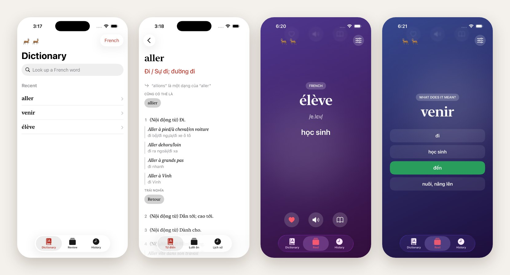

# Reindoo

Reindoo is a French and English dictionary for Vietnamese speakers, on the web and on iOS.



Look up a word, even a conjugated one, and get its Vietnamese meaning, examples and related words. The iOS app works offline: the whole dictionary ships inside it. Reels turn your lookup history into an endless deck that reads each word aloud, lets you guess, then shows the meaning.

## What's inside

- [`ios/`](ios/) is the native app, in Swift and SwiftUI. Its logic lives in a UI-free package, `ios/Core`, which builds and tests on Linux.
- [`packages/client/`](packages/client/) is the web app: TanStack Start on Cloudflare Workers.
- [`packages/server/`](packages/server/) is the API: Fastify, MongoDB and BullMQ.
- [`packages/shared/`](packages/shared/) and [`packages/task-service/`](packages/task-service/) hold the code both sides share and the background job queue.
- [`deploy/`](deploy/) sets up a server and deploys the API with Docker Compose.

## The dictionary

The entries come from the Vietnamese Wiktionary. A separate project, [dictionnaire](https://github.com/quanghuynt14/dictionnaire), compiles them. The iOS build pins one of its commits and turns its output into the SQLite file the app ships.

## Run it

The iOS core needs only Swift:

```sh
swift test --package-path ios/Core
swift run  --package-path ios/Core reindoo-cli --fixture returning ls
```

The iOS app needs a Mac with Xcode:

```sh
brew install xcodegen
cd ios && xcodegen generate && open Reindoo.xcodeproj
```

The web app and the API need Node 24, pnpm 10, MongoDB and Redis:

```sh
cp packages/server/.env.example packages/server/.env   # then fill it in
pnpm install
pnpm dev
```

[`ios/README.md`](ios/README.md) covers the app in depth, in French, like the comments in the code.

## License

Reindoo is released under the [MIT License](LICENSE). The dictionary data is not ours to relicense: see [THIRD_PARTY_NOTICES.md](THIRD_PARTY_NOTICES.md).
